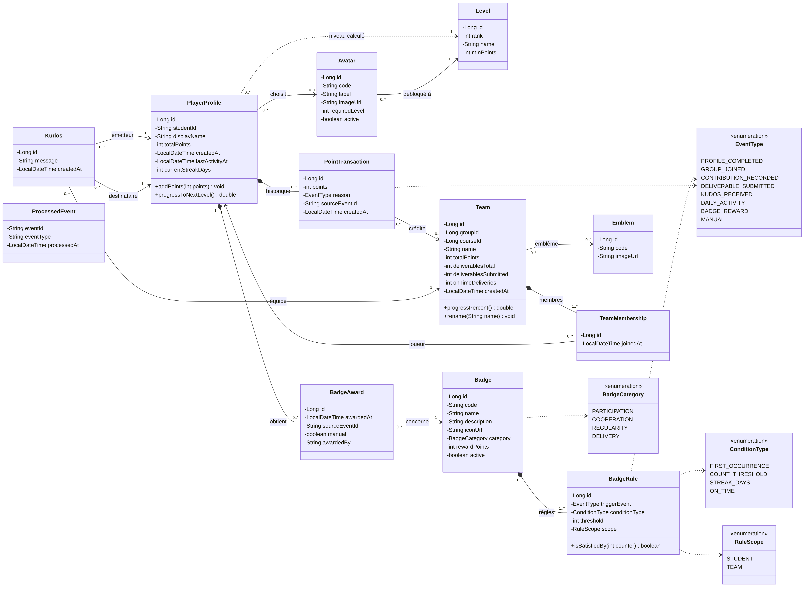
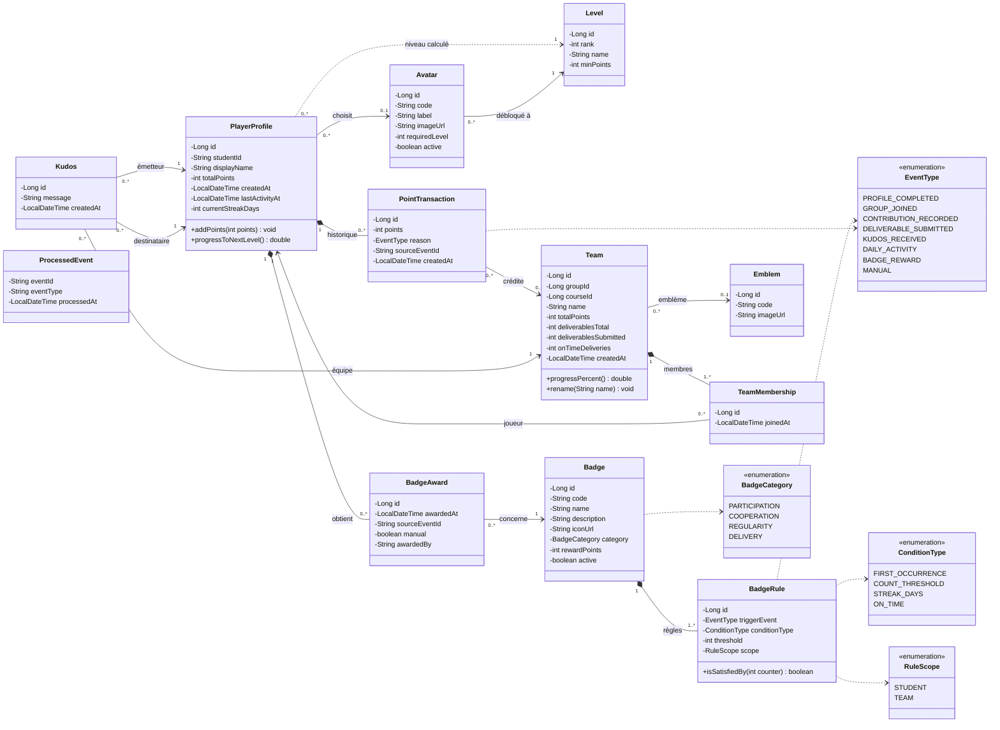
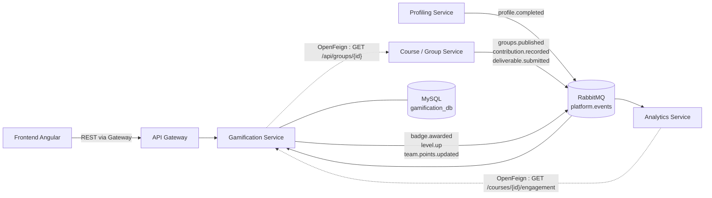
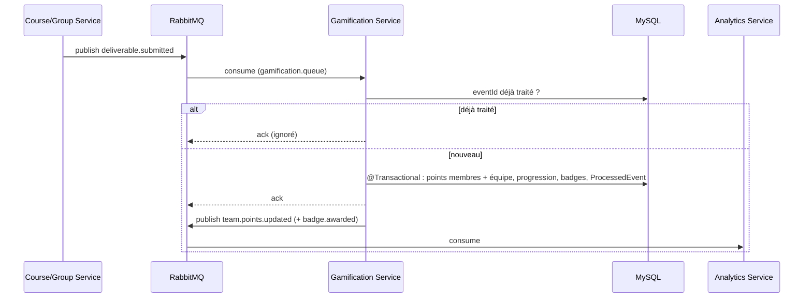

# 🏆 Gamification Service

> Microservice individuel – Mini-projet AWD 2026-2027
> **Responsable :** _Nom Prénom_ · **Stack :** Spring Boot 3 · MySQL 8 · Angular · Spring Cloud

---

## Sommaire

1. [Fiche d'identité](#1-fiche-didentité)
2. [Rôle et responsabilités](#2-rôle-et-responsabilités)
3. [Règles métier](#3-règles-métier)
4. [Diagramme de classes](#4-diagramme-de-classes)
5. [Base de données : choix de MySQL](#5-base-de-données--choix-de-mysql)
6. [Contrat d'API REST](#6-contrat-dapi-rest)
7. [Interactions du microservice](#7-interactions-du-microservice)
8. [Gestion des pannes](#8-gestion-des-pannes)
9. [Sécurité](#9-sécurité)
10. [Structure du projet Spring Boot](#10-structure-du-projet-spring-boot)
11. [Écrans Angular consommant le service](#11-écrans-angular-consommant-le-service)
12. [API Gateway du microservice](#12-api-gateway-du-microservice)
13. [Lancement et tests](#13-lancement-et-tests)
14. [Correspondance avec la grille d'évaluation](#14-correspondance-avec-la-grille-dévaluation)

---

## 1. Fiche d'identité

| Élément | Valeur |
|---|---|
| Nom du service (Eureka) | `gamification-service` |
| Port | `8084` |
| Route API Gateway | `/api/gamification/**` |
| Base de données | MySQL 8 – schéma `gamification_db` (propre au service, non partagée) |
| Communication synchrone | OpenFeign + Resilience4j |
| Communication asynchrone | RabbitMQ (Spring AMQP) – exchange topic `platform.events` |
| Sécurité | Resource Server OAuth2 / JWT émis par Keycloak |
| Documentation API | Swagger / OpenAPI (`springdoc-openapi`) → `/swagger-ui.html` |

---

## 2. Rôle et responsabilités

**Contexte borné :** *l'engagement et la motivation des étudiants et des équipes.*
Le service entretient la motivation des groupes formés par la plateforme grâce à trois leviers décrits dans la thématique : **identité**, **reconnaissance** et **visualisation**.

### Ce que le service fait

| Levier | Fonctionnalités |
|---|---|
| **Identité** | Bibliothèque d'avatars, choix de l'avatar par l'étudiant, nom et emblème de l'équipe |
| **Reconnaissance** | Attribution automatique de points et de badges à partir des événements métier, niveaux, badges manuels par l'enseignant, *kudos* (remerciement d'entraide entre coéquipiers) |
| **Visualisation** | Jauge de progression de l'équipe, répartition des contributions, classement **par équipes**, tableau de bord du joueur |

### Données propres au service

Le service ne stocke **que** les données de gamification ; il garde une copie locale minimale (`groupId`, `studentId`, appartenance à l'équipe) reçue par événement, sans jamais lire la base d'un autre service.

### Acteurs et cas d'utilisation

| Acteur | Cas d'utilisation |
|---|---|
| **Étudiant** | Choisir son avatar · consulter ses points, son niveau et ses badges · renommer son équipe et choisir son emblème · envoyer un kudos à un coéquipier · consulter le tableau de bord de l'équipe et le classement |
| **Enseignant** | Créer / modifier les badges et leurs règles · attribuer un badge manuellement · consulter les tableaux de bord des équipes et le classement de son module |
| **Administrateur** | Gérer la bibliothèque d'avatars, d'emblèmes et les niveaux |
| **Système** (autres services) | Publier les événements qui déclenchent points et badges |

### Gamification responsable

Conformément à la thématique :
- le **classement compare les équipes, jamais les individus** ; les points individuels ne sont visibles que par l'étudiant lui-même et par l'enseignant ;
- les badges récompensent la **participation et la coopération** (profil complété, régularité, entraide, rendu à temps) plutôt que la note ;
- les points de contribution sont **plafonnés par jour** pour éviter le « farming ».

---

## 3. Règles métier

### Barème des points

| Événement (`EventType`) | Source | Points | Bénéficiaire |
|---|---|---|---|
| `PROFILE_COMPLETED` | Profiling Service | +20 | Étudiant |
| `GROUP_JOINED` | Course / Group Service | +10 | Étudiant |
| `CONTRIBUTION_RECORDED` | Course / Group Service | +5 (plafond 50 / jour) | Étudiant + équipe |
| `DELIVERABLE_SUBMITTED` à temps | Course / Group Service | +30 | Chaque membre + équipe |
| `DELIVERABLE_SUBMITTED` en retard | Course / Group Service | +10 | Chaque membre + équipe |
| `KUDOS_RECEIVED` | Gamification (interne) | +5 (3 kudos envoyés max / semaine) | Destinataire + équipe |
| `DAILY_ACTIVITY` | calculé (série de jours actifs) | +2 | Étudiant |
| `MANUAL` | Enseignant | selon le badge | Étudiant |

Les points de l'équipe = somme des transactions rattachées à l'équipe.

### Niveaux

| Rang | Nom | Points minimum |
|---|---|---|
| 1 | Débutant | 0 |
| 2 | Contributeur | 100 |
| 3 | Collaborateur | 250 |
| 4 | Pilier | 500 |
| 5 | Mentor | 1000 |

Le niveau est **calculé** à partir de `totalPoints` (pas stocké) ; certains avatars ne se débloquent qu'à partir d'un niveau (`requiredLevel`).

### Badges initiaux (données de seed)

| Code | Catégorie | Règle (`triggerEvent` / `conditionType` / `threshold` / `scope`) |
|---|---|---|
| `PROFILE_DONE` – Profil complété | PARTICIPATION | `PROFILE_COMPLETED` / `FIRST_OCCURRENCE` / 1 / STUDENT |
| `FIRST_STEP` – Première contribution | PARTICIPATION | `CONTRIBUTION_RECORDED` / `FIRST_OCCURRENCE` / 1 / STUDENT |
| `ON_TIME` – Livrable à l'heure | DELIVERY | `DELIVERABLE_SUBMITTED` / `ON_TIME` / 1 / TEAM |
| `HELPER` – Entraide | COOPERATION | `KUDOS_RECEIVED` / `COUNT_THRESHOLD` / 5 / STUDENT |
| `REGULAR` – Régularité | REGULARITY | `DAILY_ACTIVITY` / `STREAK_DAYS` / 7 / STUDENT |
| `DREAM_TEAM` – Équipe exemplaire | COOPERATION | `DELIVERABLE_SUBMITTED` / `ON_TIME` / 3 / TEAM |

Un badge n'est attribué **qu'une seule fois** par étudiant (contrainte d'unicité en base).

---

## 4. Diagramme de classes



<details>
<summary>Source Mermaid (rendu automatique par GitHub)</summary>


</details>

### Explication des entités

| Entité | Rôle |
|---|---|
| `PlayerProfile` | Profil de jeu d'un étudiant. `studentId` = identifiant Keycloak (`sub` du JWT) : **référence externe**, pas de clé étrangère vers un autre service. |
| `Avatar` / `Emblem` | Catalogues d'images pour l'identité de l'étudiant et de l'équipe. |
| `Level` | Table de référence des paliers de points. |
| `Badge` / `BadgeRule` | Un badge possède une ou plusieurs règles déclenchées par un type d'événement. Les règles sont **paramétrables** par l'enseignant (pas codées en dur). |
| `BadgeAward` | Attribution d'un badge à un joueur (automatique ou manuelle). |
| `PointTransaction` | Journal (*ledger*) des points : chaque gain est tracé, explicable et rejouable. `totalPoints` est un cumul dénormalisé pour la performance. |
| `Team` / `TeamMembership` | Identité gamifiée d'un groupe. `groupId` et `courseId` sont des références vers le Course / Group Service (copie locale reçue par événement). |
| `Kudos` | Remerciement d'entraide entre deux membres d'une même équipe. |
| `ProcessedEvent` | Garantit l'**idempotence** : un événement RabbitMQ rejoué n'est jamais traité deux fois. |

> Le **classement** n'est pas une entité : il est calculé par requête (`ORDER BY total_points`) et renvoyé sous forme de DTO `LeaderboardEntryDTO`.

---

## 5. Base de données : choix de MySQL

**Pourquoi un SGBD relationnel, et MySQL en particulier :**

1. **Intégrité forte** : les règles « un badge une seule fois par étudiant » ou « un événement traité une seule fois » s'expriment directement par des contraintes `UNIQUE`.
2. **Transactions ACID** : ajouter des points, mettre à jour le total de l'équipe et attribuer un badge doit se faire **atomiquement** (`@Transactional`).
3. **Agrégations** : classement et répartition des contributions = `SUM` / `GROUP BY` / `ORDER BY`, naturels en SQL.
4. **Modèle stable et fortement relié** (badges ↔ règles ↔ attributions), donc pas besoin de la flexibilité d'un modèle document.
5. Conforme à la stack imposée (MySQL pour le microservice 4) et bien intégré à Spring Data JPA / Hibernate.

**Contraintes principales :**

| Table | Contrainte |
|---|---|
| `player_profile` | `UNIQUE(student_id)` |
| `badge` | `UNIQUE(code)` |
| `badge_award` | `UNIQUE(player_id, badge_id)` |
| `point_transaction` | `UNIQUE(player_id, source_event_id)` + index `(team_id)` |
| `team` | `UNIQUE(group_id)`, `UNIQUE(course_id, name)` |
| `team_membership` | `UNIQUE(team_id, player_id)` |
| `processed_event` | `PRIMARY KEY(event_id)` |

---

## 6. Contrat d'API REST

Base : `http://gateway:8080/api/gamification` · format JSON · pagination `?page=0&size=20`.
`me` = étudiant identifié par le JWT.

### Joueurs

| Méthode | URI | Rôle | Description | Codes |
|---|---|---|---|---|
| GET | `/players/me` | STUDENT | Profil de jeu : points, niveau, progression, avatar | 200, 401, 404 |
| GET | `/players/me/badges` | STUDENT | Badges obtenus | 200, 401 |
| GET | `/players/me/points-history` | STUDENT | Historique paginé des points | 200, 401 |
| PUT | `/players/me/avatar` | STUDENT | Choisir un avatar `{ "avatarId": 3 }` | 200, 400, 403 (avatar verrouillé), 404 |
| GET | `/players/{studentId}` | TEACHER | Profil de jeu d'un étudiant | 200, 403, 404 |

### Avatars, emblèmes, niveaux

| Méthode | URI | Rôle | Description | Codes |
|---|---|---|---|---|
| GET | `/avatars` | tous | Bibliothèque d'avatars | 200 |
| POST | `/avatars` | ADMIN | Ajouter un avatar | 201, 400, 409 (code existant) |
| DELETE | `/avatars/{id}` | ADMIN | Désactiver un avatar | 204, 404 |
| GET | `/emblems` | tous | Liste des emblèmes | 200 |
| GET | `/levels` | tous | Paliers de niveaux | 200 |

### Badges et règles

| Méthode | URI | Rôle | Description | Codes |
|---|---|---|---|---|
| GET | `/badges` | tous | Catalogue des badges | 200 |
| GET | `/badges/{id}` | tous | Détail d'un badge et de ses règles | 200, 404 |
| POST | `/badges` | TEACHER, ADMIN | Créer un badge avec ses règles | 201, 400, 409 |
| PUT | `/badges/{id}` | TEACHER, ADMIN | Modifier un badge | 200, 400, 404 |
| DELETE | `/badges/{id}` | TEACHER, ADMIN | Désactiver (soft delete, les attributions restent) | 204, 404 |
| POST | `/players/{studentId}/badges/{badgeId}` | TEACHER | Attribution manuelle | 201, 404, 409 (déjà obtenu) |

### Équipes et classement

| Méthode | URI | Rôle | Description | Codes |
|---|---|---|---|---|
| GET | `/teams/{teamId}` | membres, TEACHER | Identité de l'équipe | 200, 403, 404 |
| PATCH | `/teams/{teamId}/identity` | STUDENT membre | Nom et emblème `{ "name": "...", "emblemId": 2 }` | 200, 400, 403 (non membre), 404, 409 (nom pris dans le module) |
| GET | `/teams/{teamId}/dashboard` | membres, TEACHER | Jauge de progression, points, répartition des contributions, badges d'équipe | 200, 403, 404 |
| GET | `/courses/{courseId}/leaderboard` | STUDENT, TEACHER | Classement **des équipes** du module | 200, 404 |
| GET | `/courses/{courseId}/engagement` | TEACHER, service Analytics | Indicateurs agrégés d'engagement | 200, 404 |

### Kudos

| Méthode | URI | Rôle | Description | Codes |
|---|---|---|---|---|
| POST | `/kudos` | STUDENT | `{ "toStudentId": "...", "message": "Merci !" }` | 201, 400 (à soi-même), 403 (pas la même équipe), 429 (quota hebdo atteint) |
| GET | `/teams/{teamId}/kudos` | membres | Kudos échangés dans l'équipe | 200, 403 |

### Format d'erreur commun

```json
{
  "timestamp": "2026-11-10T09:15:00Z",
  "status": 409,
  "error": "Conflict",
  "message": "Le nom 'Les Pionniers' est déjà utilisé dans ce module",
  "path": "/api/gamification/teams/12/identity"
}
```

### Exemple – `GET /players/me`

```json
{
  "studentId": "7f3c2a1e-...",
  "displayName": "Sara B.",
  "avatar": { "id": 3, "label": "Renard", "imageUrl": "/avatars/fox.png" },
  "totalPoints": 135,
  "level": { "rank": 2, "name": "Contributeur" },
  "nextLevel": { "rank": 3, "name": "Collaborateur", "minPoints": 250 },
  "progressToNextLevel": 0.23,
  "badgesCount": 3,
  "teamId": 12
}
```

### Exemple – `GET /courses/5/leaderboard`

```json
[
  { "rank": 1, "teamId": 12, "name": "Les Pionniers", "emblemUrl": "/emblems/rocket.png", "totalPoints": 640, "progressPercent": 75.0 },
  { "rank": 2, "teamId": 9,  "name": "Data Squad",    "emblemUrl": "/emblems/owl.png",    "totalPoints": 590, "progressPercent": 50.0 }
]
```

---

## 7. Interactions du microservice



### 7.1 Communication asynchrone (RabbitMQ) – mode principal

**Justification :** l'attribution de points est une **réaction** à ce qui se passe ailleurs. Les services producteurs n'ont pas à attendre la gamification ni même à connaître son existence (couplage faible). Si le Gamification Service est arrêté, les messages restent dans la file et sont traités au redémarrage : **aucun point n'est perdu**.

**Événements consommés** (file `gamification.queue`, liée à l'exchange topic `platform.events`) :

| Routing key | Producteur | Données reçues | Traitement |
|---|---|---|---|
| `profile.completed` | Profiling | `eventId, studentId, displayName, completedAt` | Crée le `PlayerProfile` si absent, +20 pts, badge `PROFILE_DONE` |
| `groups.published` | Course / Group | `eventId, courseId, groups[{groupId, defaultName, memberIds[], deliverablesTotal}]` | Crée `Team` + `TeamMembership`, +10 pts par membre |
| `contribution.recorded` | Course / Group | `eventId, groupId, studentId, type, recordedAt` | +5 pts (plafond), mise à jour de la série de jours, badges `FIRST_STEP` / `REGULAR` |
| `deliverable.submitted` | Course / Group | `eventId, groupId, deliverableId, dueDate, submittedAt` | Progression de l'équipe, +30 ou +10 pts par membre, badges `ON_TIME` / `DREAM_TEAM` |

**Événements publiés :**

| Routing key | Données envoyées | Consommateurs |
|---|---|---|
| `badge.awarded` | `eventId, studentId, badgeCode, badgeName, awardedAt` | Analytics (indicateurs), notification front |
| `level.up` | `eventId, studentId, newLevel, reachedAt` | Analytics |
| `team.points.updated` | `eventId, teamId, groupId, courseId, totalPoints, progressPercent` | Analytics |

**Exemple de message `deliverable.submitted` :**

```json
{
  "eventId": "c1b9e7d2-4f0a-4d6e-9a51-3b2f1a7e8c90",
  "eventType": "DELIVERABLE_SUBMITTED",
  "occurredAt": "2026-11-20T17:42:00Z",
  "payload": { "groupId": 12, "deliverableId": 4, "dueDate": "2026-11-21T23:59:00Z", "submittedAt": "2026-11-20T17:42:00Z" }
}
```

**Scénario : rendu d'un livrable**



### 7.2 Communication synchrone (OpenFeign)

**Justification :** utilisée seulement quand une **réponse immédiate** est nécessaire.

| Sens | Appel | Données échangées | Quand |
|---|---|---|---|
| Gamification → Course / Group | `GET /api/groups/{groupId}` | `groupId, courseId, name, memberIds[]` | Réconciliation : un événement arrive pour une équipe inconnue localement (ex. `groups.published` perdu ou arrivé dans le désordre) |
| Analytics → Gamification | `GET /api/gamification/courses/{courseId}/engagement` | points moyens par équipe, badges distribués, taux d'étudiants actifs | Construction des indicateurs administratifs |
| Frontend → Gamification (via Gateway) | tous les endpoints du §6 | DTO JSON | Affichage des écrans |

```java
@FeignClient(name = "course-group-service", fallbackFactory = GroupClientFallbackFactory.class)
public interface GroupClient {
    @GetMapping("/api/groups/{groupId}")
    GroupDTO getGroup(@PathVariable Long groupId);
}
```

---

## 8. Gestion des pannes

| Situation | Comportement prévu |
|---|---|
| **Gamification Service arrêté** | Files RabbitMQ **durables** : les événements s'accumulent et sont traités au redémarrage. Les autres services continuent de fonctionner normalement (la gamification n'est pas sur leur chemin critique). |
| **Course / Group Service indisponible** lors d'un appel Feign | Resilience4j : *timeout* 2 s, 2 tentatives, puis **circuit breaker** ouvert. Le *fallback* lève une exception récupérable : le message est rejeté et **re-livré plus tard** (retry avec délai) au lieu d'être perdu. |
| **Message en échec répété** (données invalides) | Après 3 tentatives → **Dead Letter Queue** `gamification.dlq` pour analyse, sans bloquer la file. |
| **Message reçu deux fois** (at-least-once) | Idempotence : vérification dans `processed_event` + contraintes `UNIQUE` sur `point_transaction` et `badge_award`. |
| **RabbitMQ indisponible** à la publication de `badge.awarded` | La transaction métier est déjà validée ; la publication est retentée (retry Spring AMQP). Évolution possible : *pattern Outbox*. |
| **MySQL indisponible** | Le service renvoie `503 Service Unavailable` ; l'*actuator health* passe à `DOWN` et Eureka / la Gateway arrêtent de router vers l'instance. |

---

## 9. Sécurité

- Le service est un **OAuth2 Resource Server** : il valide le JWT émis par Keycloak (realm de la plateforme) transmis par la Gateway.
- Rôles du realm utilisés : `STUDENT`, `TEACHER`, `ADMIN` → `@PreAuthorize("hasRole('TEACHER')")`.
- L'identité de l'étudiant (`studentId`) est **toujours lue depuis le token** (`sub`), jamais depuis le corps de la requête → un étudiant ne peut pas s'attribuer des points.
- Vérifications métier : seul un membre peut renommer son équipe ; un kudos n'est possible qu'entre membres de la même équipe.
- Les appels Feign inter-services propagent le token (ou utilisent un client *client_credentials* Keycloak).

---

## 10. Structure du projet Spring Boot

```
gamification-service/
├── pom.xml
├── Dockerfile
├── docker-compose.dev.yml         MySQL + RabbitMQ + Keycloak pour le développement
├── keycloak/groupify-realm.json   realm importé : rôles, clients, utilisateurs de test
├── docs/                          diagramme de classes (.png, .svg, .mmd)
└── src/
    ├── main/java/tn/esprit/gamification/
    │   ├── GamificationServiceApplication.java
    │   ├── entity/       PlayerProfile, Avatar, Level, Badge, BadgeRule, BadgeAward, PointTransaction,
    │   │                 Team, Emblem, TeamMembership, Kudos, ProcessedEvent
    │   ├── enums/        EventType, BadgeCategory, ConditionType, RuleScope
    │   ├── repository/   interfaces Spring Data JPA (12)
    │   ├── dto/          records d'entrée / sortie (PlayerDtos, BadgeDtos, TeamDtos, CatalogDtos)
    │   ├── mapper/       GamificationMapper (entité -> DTO)
    │   ├── service/      PointService, BadgeEngine, LevelService, PlayerService, TeamService,
    │   │                 KudosService, BadgeService, CatalogService, EventProcessingService
    │   ├── controller/   PlayerController, BadgeController, TeamController, KudosController,
    │   │                 CatalogController, DevEventController (profil dev)
    │   ├── messaging/    RabbitConfig, EventConsumer, EventPublisher, event/ (enveloppe + payloads)
    │   ├── client/       GroupClient (OpenFeign), GroupClientFallbackFactory, FeignAuthConfig
    │   ├── security/     SecurityConfig, KeycloakRoleConverter, CurrentUser, CurrentUserProvider
    │   ├── config/       GamificationProperties, OpenApiConfig, DataSeeder (données initiales)
    │   └── exception/    ApiException, ApiError, GlobalExceptionHandler
    ├── main/resources/application.yml
    └── test/java/.../DomainRulesTest.java
```

**Dépendances Maven :** `spring-boot-starter-web`, `spring-boot-starter-data-jpa`, `mysql-connector-j`, `spring-boot-starter-validation`, `spring-cloud-starter-netflix-eureka-client`, `spring-cloud-starter-config`, `spring-cloud-starter-openfeign`, `spring-cloud-starter-circuitbreaker-resilience4j`, `spring-boot-starter-amqp`, `spring-boot-starter-oauth2-resource-server`, `spring-boot-starter-oauth2-client`, `springdoc-openapi-starter-webmvc-ui`, `spring-boot-starter-actuator`, `lombok`.

**`application.yml` (extrait) :**

```yaml
server:
  port: 8084
spring:
  application:
    name: gamification-service
  datasource:
    url: jdbc:mysql://localhost:3306/gamification_db?createDatabaseIfNotExist=true
    username: root
    password: root
  jpa:
    hibernate:
      ddl-auto: update
  rabbitmq:
    host: localhost
    port: 5672
  security:
    oauth2:
      resourceserver:
        jwt:
          issuer-uri: http://localhost:8180/realms/groupify
eureka:
  client:
    service-url:
      defaultZone: http://localhost:8761/eureka
```

---

## 11. Écrans Angular consommant le service

| Écran / composant | Endpoints utilisés |
|---|---|
| `AvatarPickerComponent` – choix de l'avatar | `GET /avatars`, `PUT /players/me/avatar` |
| `PlayerCardComponent` – points, niveau, barre de progression | `GET /players/me` |
| `BadgeWallComponent` – mur de badges (obtenus / verrouillés) | `GET /badges`, `GET /players/me/badges` |
| `TeamIdentityComponent` – nom et emblème de l'équipe | `GET /emblems`, `PATCH /teams/{id}/identity` |
| `TeamDashboardComponent` – jauge, répartition des contributions (graphique) | `GET /teams/{id}/dashboard` |
| `LeaderboardComponent` – classement des équipes | `GET /courses/{id}/leaderboard` |
| `KudosDialogComponent` – remercier un coéquipier | `POST /kudos` |
| `BadgeAdminComponent` (enseignant) – gestion des badges et règles | `POST/PUT/DELETE /badges` |

---

## 12. API Gateway du microservice

Projet séparé : `api-gateway/` (Spring Cloud Gateway, port **8080**). C'est le point d'entrée unique du front Angular vers le Gamification Service.

```
Angular :4200 ──► API Gateway :8080 ──lb://gamification-service──► Gamification Service :8084 ──► MySQL
                    ├─ vérifie le JWT Keycloak (401 sinon)              ▲
                    ├─ CORS pour http://localhost:4200                  │ adresse obtenue auprès d'Eureka :8761
                    ├─ CircuitBreaker + fallback 503
                    └─ en-tête X-Correlation-Id + logs
```

| Route | Prédicat | Cible | Filtres |
|---|---|---|---|
| `gamification-service` | `Path=/api/gamification/**` | `lb://gamification-service` | `CircuitBreaker` (`gamificationCB`, fallback `forward:/fallback/gamification-service`) |
| `gamification-docs` | `Path=/docs/gamification/**` | `lb://gamification-service` | `RewritePath` → `/v3/api-docs` (Swagger accessible via la Gateway) |

| Fichier | Rôle |
|---|---|
| `application.yml` | Routes, Eureka, Resilience4j (timeout 5 s, circuit ouvert à 50 % d'échecs), CORS, Swagger |
| `security/SecurityConfig.java` | Toute requête `/api/**` exige un JWT valide ; `OPTIONS`, santé, Swagger et fallback publics |
| `security/KeycloakReactiveJwtConverter.java` | Rôles Keycloak `realm_access.roles` → `ROLE_STUDENT`, `ROLE_TEACHER`, `ROLE_ADMIN` |
| `web/FallbackController.java` | Réponse **503** JSON quand le Gamification Service est arrêté, lent ou que le circuit est ouvert |
| `filter/CorrelationIdFilter.java` | Ajoute `X-Correlation-Id` à chaque requête et journalise méthode, chemin, statut, durée |

**Choix justifiés :**
- **Sécurité en deux niveaux** : la Gateway refuse les requêtes sans jeton ; le microservice revalide le jeton et contrôle les rôles (`@PreAuthorize`).
- **`lb://`** : la Gateway ne connaît pas l'adresse du service, elle la demande à Eureka ; plusieurs instances peuvent tourner, la charge est répartie.
- **CORS dans la chaîne de sécurité** : les requêtes *preflight* `OPTIONS` d'Angular passent avant l'authentification.
- **Circuit breaker** : le front reçoit un 503 clair au lieu d'attendre un timeout.

---

## 13. Lancement et tests

### 13.0 Démarrage rapide sans Docker (profil `local`)

Seul **MySQL** est nécessaire (XAMPP / WAMP). Keycloak, RabbitMQ et Eureka sont désactivés.

1. Démarrer MySQL (XAMPP → *Start*). Utilisateur `root`, mot de passe vide par défaut ; sinon modifier `password` dans `application-local.yml`.
2. IntelliJ → *Run → Edit Configurations* → `GamificationServiceApplication` → **Active profiles : `local`** → ▶.
   Ou : `mvn spring-boot:run -Dspring-boot.run.profiles=local`
3. Ouvrir http://localhost:8084/swagger-ui.html : tous les endpoints sont testables sans jeton.

| Élément | En profil `local` |
|---|---|
| Utilisateur connecté | `student1` avec les rôles STUDENT, TEACHER, ADMIN |
| Changer d'étudiant | Swagger → **Authorize** → `X-User-Id` = `student2` (ou en-tête `X-User-Id` dans Postman) |
| Limiter les rôles | en-tête `X-User-Roles: STUDENT` (Postman) |
| Événements | `POST /api/gamification/dev/events/{routingKey}` les traite directement (sans RabbitMQ) |
| Événements publiés | écrits dans la console au lieu d'être envoyés à RabbitMQ |

Scénario de démo dans Swagger : `groups.published` avec `"memberIds":["student1","student2"]`, puis `profile.completed` et `deliverable.submitted` (corps de la section 13.2, en remplaçant `S1_ID` / `S2_ID` par `student1` / `student2`), puis `GET /players/me`, `GET /teams/1/dashboard`, `GET /courses/1/leaderboard`.

**Passer par l'API Gateway (facultatif)** : lancer aussi `api-gateway` avec le profil **`local`** (*Active profiles : `local`*, ou `mvn spring-boot:run -Dspring-boot.run.profiles=local`). La Gateway route alors directement vers `http://localhost:8084` (sans Eureka) et ne demande pas de jeton (sans Keycloak). Le CORS, le circuit breaker et `X-Correlation-Id` restent actifs.

| Démo via la Gateway | Résultat |
|---|---|
| `GET http://localhost:8080/api/gamification/players/me` | Réponse du service, en-tête `X-Correlation-Id` ajouté |
| Swagger via la Gateway : http://localhost:8080/swagger-ui.html | Documentation du service servie par la Gateway |
| Arrêter le service, refaire l'appel | **503** JSON du `FallbackController` (circuit breaker) |

> Ces profils servent uniquement à la démonstration. La sécurité Keycloak et la découverte Eureka réelles (profil par défaut) restent dans le code : `security/SecurityConfig.java` des deux projets.

### Démarrage complet (Docker : MySQL + RabbitMQ + Keycloak)

**Prérequis :** JDK 17+, Maven, Docker Desktop, un serveur Eureka sur le port 8761 (infrastructure commune).

```bash
# 1. Infrastructure du service : MySQL, RabbitMQ, Keycloak (realm "groupify" importé automatiquement)
cd gamification-service
docker compose -f docker-compose.dev.yml up -d

# 2. Le microservice (profil dev = endpoint de simulation d'événements)
mvn spring-boot:run -Dspring-boot.run.profiles=dev

# 3. L'API Gateway
cd ../api-gateway
mvn spring-boot:run
```

| URL | Accès |
|---|---|
| Swagger du service | http://localhost:8084/swagger-ui.html |
| Swagger via la Gateway | http://localhost:8080/swagger-ui.html |
| RabbitMQ | http://localhost:15672 (guest / guest) |
| Keycloak | http://localhost:8180 (admin / admin) |

Comptes de test : `student1`, `student2`, `teacher1`, `admin1` (mot de passe = nom d'utilisateur).

### 13.1 Obtenir un jeton

```bash
curl -s -X POST http://localhost:8180/realms/groupify/protocol/openid-connect/token \
  -d grant_type=password -d client_id=angular-frontend -d username=teacher1 -d password=teacher1
```

Copier `access_token` (Swagger : bouton **Authorize**). Faire de même pour `student1` et `student2`, puis appeler `GET /api/gamification/players/me` avec chacun pour noter leur `studentId` (`S1_ID`, `S2_ID`).

### 13.2 Simuler les événements reçus (profil `dev`, jeton enseignant)

```bash
curl -X POST http://localhost:8080/api/gamification/dev/events/groups.published \
  -H "Authorization: Bearer $TOKEN_TEACHER" -H "Content-Type: application/json" \
  -d '{"courseId":1,"groups":[{"groupId":10,"name":"Les Pionniers","memberIds":["S1_ID","S2_ID"],"deliverablesTotal":4}]}'

curl -X POST http://localhost:8080/api/gamification/dev/events/profile.completed \
  -H "Authorization: Bearer $TOKEN_TEACHER" -H "Content-Type: application/json" \
  -d '{"studentId":"S1_ID","displayName":"Sara Ben Ali","completedAt":"2026-11-10T09:00:00Z"}'

curl -X POST http://localhost:8080/api/gamification/dev/events/contribution.recorded \
  -H "Authorization: Bearer $TOKEN_TEACHER" -H "Content-Type: application/json" \
  -d '{"groupId":10,"studentId":"S1_ID","type":"COMMIT","recordedAt":"2026-11-10T10:00:00Z"}'

curl -X POST http://localhost:8080/api/gamification/dev/events/deliverable.submitted \
  -H "Authorization: Bearer $TOKEN_TEACHER" -H "Content-Type: application/json" \
  -d '{"groupId":10,"deliverableId":1,"dueDate":"2026-11-21T23:59:00Z","submittedAt":"2026-11-20T17:00:00Z"}'
```

### 13.3 Vérifier

```bash
curl http://localhost:8080/api/gamification/players/me            -H "Authorization: Bearer $TOKEN_S1"
curl http://localhost:8080/api/gamification/players/me/badges     -H "Authorization: Bearer $TOKEN_S1"
curl http://localhost:8080/api/gamification/teams/1/dashboard     -H "Authorization: Bearer $TOKEN_S1"
curl http://localhost:8080/api/gamification/courses/1/leaderboard -H "Authorization: Bearer $TOKEN_S1"
curl -X POST http://localhost:8080/api/gamification/kudos -H "Authorization: Bearer $TOKEN_S1" \
  -H "Content-Type: application/json" -d '{"toStudentId":"S2_ID","message":"Merci pour ton aide !"}'
```

Attendu pour student1 : 10 + 20 + 10 (badge `PROFILE_DONE`) + 5 + 2 + 10 (badge `FIRST_STEP`) + 30 + 15 (badge `ON_TIME`) = **102 points → niveau 2 « Contributeur »**.

### 13.4 Résilience à démontrer

| Test | Résultat attendu |
|---|---|
| Appel sans jeton via la Gateway | **401** |
| Service arrêté, appel via la Gateway | **503** JSON du `FallbackController` |
| Service arrêté, événements publiés, puis redémarrage | Les messages attendaient dans `gamification.queue`, les points sont attribués |
| Même événement publié deux fois | Ignoré la 2e fois (`processed_event`) |
| `contribution.recorded` pour un `groupId` inconnu | Appel Feign ; en échec → 3 tentatives puis message dans `gamification.dlq` |

Tests unitaires : `mvn test`.

---

## 14. Correspondance avec la grille d'évaluation

| Exigence (grille / rendu demandé) | Où la trouver |
|---|---|
| **I1** – Responsabilités | §2 |
| **I1** – Entités et modèle de données (diagramme de classes) | §4, `docs/diagramme-classes-gamification.png`, package `entity/` |
| **I1** – Choix de la base justifié | §5 (MySQL, contraintes) |
| **I1** – API REST : ressources, URI, méthodes, codes de statut | §6, Swagger `/swagger-ui.html` |
| **I2** – Services appelés et appelants, données échangées | §7 |
| **I2** – Mode synchrone / asynchrone justifié | §7.1 (RabbitMQ), §7.2 (OpenFeign) |
| **I2** – Comportement si un service est indisponible | §8, §13.4 |
| Contrat d'API : endpoints, codes, **événements** | §6 et §7.1 |
| **I3** – Projet créé dans `Backend/`, compile et démarre | `gamification-service/`, §13 |
| Une base par microservice | `gamification_db`, propre au service (§1, §5) |
| Enregistrement Eureka | `spring.application.name: gamification-service`, client Eureka (§1) |
| Swagger / OpenAPI | `springdoc-openapi`, `OpenApiConfig` |
| Sécurité Keycloak | §9, `security/` |
| API Gateway | §12, projet `api-gateway/` |
| Dockerisation | `Dockerfile` des deux projets |
